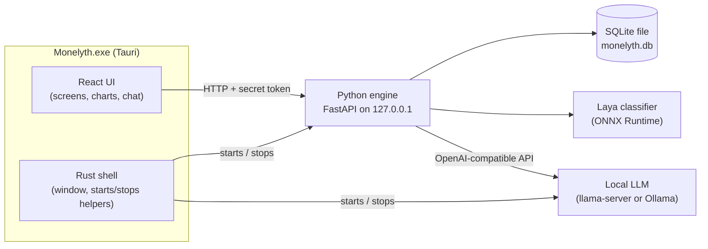
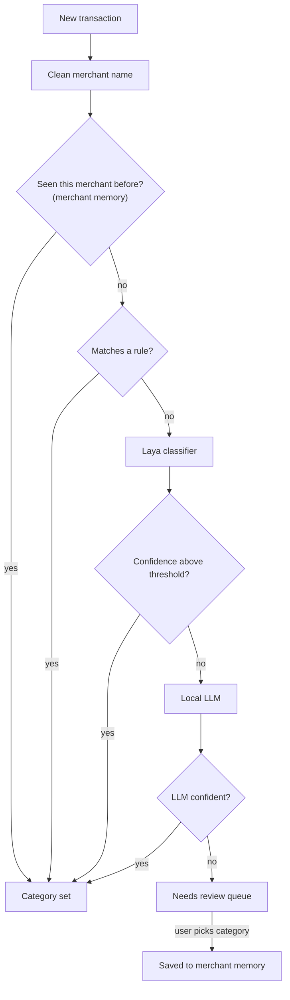
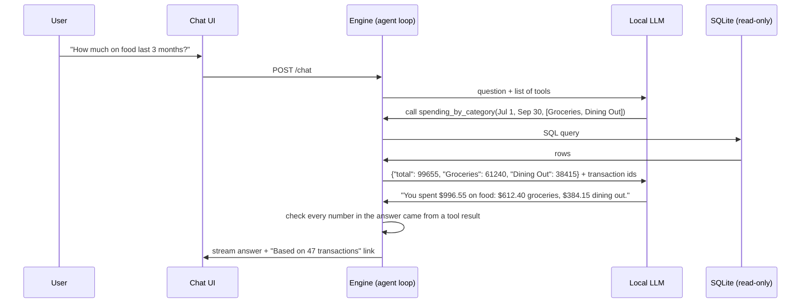

# Monelyth — Build Plan

A private, offline personal-finance desktop app. You drop in your bank statements, Monelyth sorts every transaction into a category, tracks your income and spending, and lets you ask questions about your money through an AI model that runs on your own computer. Nothing leaves your machine.

**Who it's for:** you first (portfolio project), then anyone who downloads it from LinkedIn/GitHub. That means two bars to clear: the code has to be clean enough to show employers, and the install has to be simple enough for a non-technical person.

---

## Table of contents

1. [Key decisions](#1-key-decisions)
2. [How the app fits together](#2-how-the-app-fits-together)
3. [Repository layout](#3-repository-layout)
4. [Data model](#4-data-model)
5. [Phases](#5-phases)
   - [Phase 0 — Foundations and a "walking skeleton"](#phase-0--foundations-and-a-walking-skeleton)
   - [Phase 1 — Data engine](#phase-1--data-engine)
   - [Phase 2 — Desktop app and core screens](#phase-2--desktop-app-and-core-screens)
   - [Phase 3 — Categorization](#phase-3--categorization)
   - [Phase 4 — Insights and dashboard](#phase-4--insights-and-dashboard)
   - [Phase 5 — Local AI chat](#phase-5--local-ai-chat)
   - [Phase 6 — Packaging and the v0.1 release](#phase-6--packaging-and-the-v01-release)
   - [Phase 7 — PDF statements and autopilot (v0.2)](#phase-7--pdf-statements-and-autopilot-v02)
   - [Phase 8 — Hardening and growth (v0.3+)](#phase-8--hardening-and-growth-v03)
6. [Privacy rules (apply to every phase)](#6-privacy-rules-apply-to-every-phase)
7. [Testing strategy](#7-testing-strategy)
8. [Risks and how we handle them](#8-risks-and-how-we-handle-them)
9. [Release milestones](#9-release-milestones)
10. [Glossary](#10-glossary)

---

## 1. Key decisions

These are defaults I picked so the plan is concrete. Any of them can change; the plan notes where a change would ripple.

| Decision | Choice | Why | Main alternative |
|---|---|---|---|
| App type | **Desktop app** | Data stays on the device by design; feels like a real product | Local web app in the browser (easier to build, harder for non-technical users) |
| Desktop framework | **Tauri 2** (Rust shell + web UI) | Small installer (shell is ~10 MB vs ~100 MB+ for Electron), low memory use, Rust on a resume | Electron (more tutorials, much larger app) |
| UI | **React + TypeScript + Vite + Tailwind + shadcn/ui** | Modern, good-looking components out of the box, which matters because design is a selling point | Svelte, Vue |
| Engine (the "brain") | **Python 3.12+ with FastAPI**, shipped inside the app as a "sidecar" | Python has the best tools for ML models, PDF parsing and data work | Doing everything in Rust (much harder for ML) |
| Database | **SQLite**, one file on the user's computer | Zero setup, fast, easy to back up or delete, industry standard for local apps | DuckDB (better for analytics, less common for app data) |
| Classifier | **Laya Typed-Decisions** (ConvAI Innovations, Apache 2.0), pending an evaluation in Phase 3 | Free, open source, runs locally | Small embedding model + nearest-neighbour matching (see Phase 3) |
| Model runtime for the classifier | **ONNX Runtime** | Runs models without PyTorch, which keeps the installer hundreds of MB smaller | PyTorch (too big to ship) |
| Local LLM runtime | **Ollama during development; bundled llama.cpp `llama-server` in the release** | Both speak the same OpenAI-style API, so the code doesn't change. Bundling means users don't install anything extra | Require users to install Ollama |
| First platform | **Windows** (installer `.exe`), macOS later | You're on Windows; most of your LinkedIn audience likely is too | Ship both at once (doubles testing work) |
| First statement format | **CSV and OFX/QFX first, PDF in v0.2** | CSV/OFX are structured and reliable; PDF parsing is a project of its own | PDF first (slower to a working app) |

---

## 2. How the app fits together



**The four pieces:**

1. **Rust shell (Tauri).** Opens the window, starts the Python engine and the LLM server when the app launches, and shuts them down when it closes. You'll write very little Rust: mostly "start this program and tell the UI which port it's on."
2. **React UI.** Everything the user sees. It talks to the engine over HTTP like a normal web app talks to a server, except the server is on the same computer.
3. **Python engine.** Does the real work: reads statement files, cleans merchant names, categorizes transactions, computes totals, and runs the chat. It owns the database.
4. **Local LLM server.** A separate program (`llama-server`) that loads the AI model and answers requests. It's separate because model loading is heavy and we only want to start it when chat or LLM categorization is needed.

**Why the engine is a separate program instead of being built into the UI:** the ML and PDF libraries we need live in Python. Running Python as a sidecar keeps each piece in the language it's best at, and lets you test the engine on its own with no UI.

**How the UI and engine find each other (the handshake):**

1. The Rust shell generates a random secret token.
2. It starts the engine with `MONELYTH_TOKEN=<token>` and `--data-dir <app data folder>`.
3. The engine picks a free port, binds to `127.0.0.1` only (not reachable from the network), and prints `MONELYTH_READY {"port": 51234}` to its output.
4. The shell reads that line and gives the port and token to the UI.
5. Every UI request includes the header `Authorization: Bearer <token>`. Without it, the engine refuses. This stops other programs, and malicious websites open in your browser, from reading your data off `localhost`.

---

## 3. Repository layout

```
monelyth/
├── apps/
│   └── desktop/                 # Tauri app
│       ├── src/                 # React UI (TypeScript)
│       │   ├── screens/         # Onboarding, Import, Transactions, Dashboard, Chat, Settings
│       │   ├── components/      # shared UI pieces (components/ui = shadcn-style primitives)
│       │   ├── engine/          # engine status, HTTP client (typed client generated in Phase 2)
│       │   └── lib/             # small shared helpers
│       └── src-tauri/           # Rust shell + tauri.conf.json
│           ├── src/engine.rs    # starts, supervises and stops the engine sidecar
│           └── binaries/        # built sidecar lands here (git-ignored)
├── engine/                      # Python package (uv project)
│   ├── src/monelyth_engine/
│   │   ├── api/                 # FastAPI routes (thin: validate, call services, return)
│   │   ├── db/                  # connection, migrations/*.sql, queries
│   │   ├── ingest/              # csv.py, ofx.py, pdf/ (one parser per bank)
│   │   ├── normalize/           # merchant name cleaning
│   │   ├── categorize/          # memory, rules, classifier, llm_fallback, pipeline
│   │   ├── insights/            # aggregates, recurring, transfers, income
│   │   ├── chat/                # llm client, tools, agent loop, guardrails
│   │   ├── app.py               # FastAPI app factory + middleware
│   │   ├── config.py            # command-line / environment settings
│   │   ├── security.py          # per-launch token check
│   │   └── __main__.py          # starts the server, prints the READY line
│   ├── scripts/                 # build_sidecar.py (PyInstaller + smoke test), later eval scripts
│   ├── tests/
│   └── pyproject.toml
├── .github/workflows/ci.yml     # lint, type-check, test, build installer on every push
├── sample-data/                 # FAKE statements only (safe to commit)
├── private-data/                # YOUR real statements and labels (git-ignored, never committed)
├── docs/
└── PLAN.md
```

Each folder under `monelyth_engine/` has one job and can be tested alone. For example, `ingest/` turns a file into a list of raw transactions and knows nothing about categories; `categorize/` takes transactions and returns categories and knows nothing about files.

---

## 4. Data model

All money is stored as **integer cents** (`-1299` = $12.99 spent). Never use floating point for money: `0.1 + 0.2` is `0.30000000000000004` in floating point, and those errors add up in totals.

**Sign convention:** negative = money out, positive = money in, for every account type. Credit card statements often show purchases as positive; the importer flips them so the whole app uses one rule.

```sql
-- Bank accounts and cards the user has added
CREATE TABLE accounts (
  id            INTEGER PRIMARY KEY,
  name          TEXT NOT NULL,                 -- "Main Checking"
  institution   TEXT,                          -- "TD", "RBC", ...
  type          TEXT NOT NULL CHECK (type IN ('checking','savings','credit_card','other')),
  currency      TEXT NOT NULL                  -- chosen during onboarding, e.g. 'CAD', 'USD'
);

-- Spending/income categories (seeded with defaults, user can add more later)
CREATE TABLE categories (
  id            INTEGER PRIMARY KEY,
  name          TEXT NOT NULL UNIQUE,          -- "Groceries"
  kind          TEXT NOT NULL CHECK (kind IN ('income','expense','transfer')),
  parent_id     INTEGER REFERENCES categories(id)
);

-- One row per file the user imported
CREATE TABLE imports (
  id            INTEGER PRIMARY KEY,
  account_id    INTEGER NOT NULL REFERENCES accounts(id),
  file_name     TEXT NOT NULL,
  file_sha256   TEXT NOT NULL UNIQUE,          -- importing the exact same file twice is rejected
  format        TEXT NOT NULL CHECK (format IN ('csv','ofx','pdf')),
  imported_at   TEXT NOT NULL,                 -- ISO timestamp
  row_count     INTEGER NOT NULL
);

-- The core table
CREATE TABLE transactions (
  id               INTEGER PRIMARY KEY,
  account_id       INTEGER NOT NULL REFERENCES accounts(id),
  import_id        INTEGER REFERENCES imports(id),
  posted_date      TEXT NOT NULL,              -- 'YYYY-MM-DD'
  amount_cents     INTEGER NOT NULL,           -- negative = out, positive = in
  description_raw  TEXT NOT NULL,              -- exactly what the bank wrote
  merchant         TEXT,                       -- cleaned name, e.g. "Blue Bottle"
  category_id      INTEGER REFERENCES categories(id),
  category_source  TEXT CHECK (category_source IN ('memory','rule','classifier','llm','user')),
  confidence       REAL,                       -- 0..1; NULL when the user set it
  needs_review     INTEGER NOT NULL DEFAULT 0, -- 1 = shown in the review queue
  transfer_group   TEXT,                       -- links both sides of a transfer between accounts
  fingerprint      TEXT NOT NULL UNIQUE        -- dedupe key (see Phase 1)
);
CREATE INDEX ix_tx_account_date  ON transactions(account_id, posted_date);
CREATE INDEX ix_tx_category_date ON transactions(category_id, posted_date);

-- "This merchant is always this category", learned from the user's corrections
CREATE TABLE merchant_memory (
  merchant      TEXT PRIMARY KEY,
  category_id   INTEGER NOT NULL REFERENCES categories(id),
  source        TEXT NOT NULL CHECK (source IN ('user','llm','classifier')), -- 'user' always wins
  updated_at    TEXT NOT NULL
);

-- Keyword/regex rules: shipped defaults plus user-made ones
CREATE TABLE rules (
  id            INTEGER PRIMARY KEY,
  pattern       TEXT NOT NULL,                 -- "uber eats"
  match_type    TEXT NOT NULL CHECK (match_type IN ('contains','regex')),
  category_id   INTEGER NOT NULL REFERENCES categories(id),
  priority      INTEGER NOT NULL DEFAULT 0,    -- higher runs first ("uber eats" before "uber")
  created_by    TEXT NOT NULL CHECK (created_by IN ('system','user'))
);

-- Remembers how each bank's CSV is laid out so the user only maps columns once
CREATE TABLE csv_profiles (
  header_signature TEXT PRIMARY KEY,           -- hash of the CSV header row
  mapping_json     TEXT NOT NULL               -- {"date": 0, "description": 1, "amount": 3, ...}
);

-- Chat history
CREATE TABLE chat_messages (
  id               INTEGER PRIMARY KEY,
  conversation_id  TEXT NOT NULL,
  role             TEXT NOT NULL CHECK (role IN ('user','assistant','tool')),
  content          TEXT NOT NULL,
  tool_calls_json  TEXT,
  created_at       TEXT NOT NULL
);
```

**Migrations:** numbered SQL files (`001_init.sql`, `002_add_rules.sql`, ...). SQLite has a built-in counter, `PRAGMA user_version`; on startup the engine runs every file whose number is higher than the counter, then updates it. This means users who update the app keep their data.

**Where files live on Windows:** the database at `%APPDATA%\Monelyth\monelyth.db`, downloaded models at `%LOCALAPPDATA%\Monelyth\models\`. Tauri provides these paths, so the code works on macOS later without changes.

---

## 5. Phases

Effort estimates are rough guesses for about 10–15 hours a week. Each phase ends with a "Done when" check, so you know it's finished and not just "mostly working."

Each step has a checkbox so you can track progress in this file.

---

### Phase 0 — Foundations and a "walking skeleton"

**Goal:** a tiny app that goes all the way from code to installer: a Tauri window starts the Python engine, the UI shows "Engine connected," and it all installs from one `.exe`. We do packaging first because it's the riskiest part. If bundling Python inside Tauri has a problem, we want to find out in week 1, not week 12.

**Effort:** ~1 week

> **Status (2026-10-17):** built and verified locally. The installer builds, the installed UI reaches the engine, and the engine stops with the app. CI is green on GitHub (merged in PR #1). Still open: Ollama (not needed until Phase 3) and a clean-machine test in Windows Sandbox (0.6).

- [ ] **0.1 Install the toolchain**
  - Git, Python 3.12+ and [`uv`](https://docs.astral.sh/uv/) (fast Python package/env manager), Node 22 LTS and `pnpm`, Rust via `rustup`, and the Microsoft C++ Build Tools (Tauri needs them on Windows). WebView2, which Tauri uses to draw the UI, is already installed on Windows 11.
  - Install [Ollama](https://ollama.com) and pull a small model for development.
- [x] **0.2 Create the repository**
  - `git init`, create a GitHub repo, and add a `.gitignore` that excludes `*.db`, `private-data/`, `models/`, `node_modules/`, `target/`, `dist/`, and `.venv/`.
  - Pick a license. MIT is simplest for a portfolio project; AGPL stops others from turning your code into a closed paid service.
- [x] **0.3 Scaffold the engine**
  - `uv init engine`, then add `fastapi`, `uvicorn`, `pydantic`.
  - Add a `GET /health` route that returns `{"status": "ok", "version": "0.0.1"}`.
  - `main.py`: read `--data-dir` and `MONELYTH_TOKEN`, bind to `127.0.0.1` on port 0 (the OS picks a free port), print the `MONELYTH_READY {"port": ...}` line, then serve.
  - Add token-checking middleware (reject requests without the right `Authorization` header), and CORS that only allows the Tauri webview origin (`http://tauri.localhost` on Windows).
  - Dev tools: `ruff` (lint + format), `pytest`, `pyright` (type checking).
- [x] **0.4 Scaffold the desktop app**
  - `pnpm create tauri-app` → React + TypeScript template. Add Tailwind and shadcn/ui.
- [x] **0.5 Connect the sidecar**
  - In `tauri.conf.json`, list the engine under `bundle.externalBin` (e.g. `binaries/monelyth-engine`). Tauri expects the file to carry the platform name: `monelyth-engine-x86_64-pc-windows-msvc.exe`.
  - Use `tauri-plugin-shell` to start it: `app.shell().sidecar("monelyth-engine")`, pass the token as an environment variable, read stdout until the READY line, and store the port.
  - Expose a Tauri command `get_engine_info()` that returns `{port, token}` to the UI.
  - Kill the sidecar when the window closes.
  - UI: call `/health` and show a green "Engine connected" badge.
- [ ] **0.6 Packaging spike**
  - Build the engine into one `.exe` with PyInstaller (`--onefile` to start; it's the easiest fit with `externalBin`). Copy it into `src-tauri/binaries/` under the platform name.
  - `pnpm tauri build` → NSIS installer (`Monelyth_0.0.1_x64-setup.exe`).
  - Test it in **Windows Sandbox** (a built-in, throwaway clean copy of Windows; enable it under "Turn Windows features on or off"). Install, launch, and confirm the green badge.
- [x] **0.7 Continuous integration**
  - A GitHub Actions workflow on `windows-latest` that, on every push, runs ruff, pyright, pytest, the frontend type-check and tests, and builds the installer as a downloadable artifact.

**Done when:** the installer that CI builds installs on a clean Windows Sandbox and shows "Engine connected."

---

### Phase 1 — Data engine

**Goal:** the engine can import CSV and OFX files, clean them up, save them without duplicates, and serve them over its API. No UI work in this phase; everything is tested with pytest.

**Effort:** ~2 weeks

> **Status (2026-10-17):** done. Built as four parallel pieces against shared types in `ingest/models.py`, then wired together by `services/importing.py` and the routes in `api/`. The done-when check is an automated test (`tests/api/test_imports.py::test_phase_1_done_when_importing_twice_adds_nothing`), and the sidecar smoke test imports a CSV and previews an OFX file through the frozen executable. Known limitation: CSV and OFX exports of the *same* account don't deduplicate against each other (OFX rows are keyed by the bank's `FITID`, CSV rows by their contents), so pick one format per account.

- [x] **1.1 Database setup**
  - Open SQLite with `PRAGMA journal_mode=WAL` (lets reads and writes happen at the same time) and `PRAGMA foreign_keys=ON` (SQLite has it off by default).
  - Write the migration runner described in [Data model](#4-data-model) and `001_init.sql` with the tables above.
  - Seed the default categories: Salary, Other Income, Rent/Mortgage, Utilities, Groceries, Dining Out, Coffee, Transport, Gas, Rideshare, Shopping, Subscriptions, Entertainment, Health, Education, Travel, Fees & Interest, Gifts & Donations, Transfers, Other.
- [x] **1.2 Sample data generator** (`engine/scripts/generate_sample_data.py`)
  - Uses `Faker` plus hand-written merchant lists to produce 12 months of realistic CSVs for a fake checking account and a fake credit card: bi-weekly salary, monthly rent, groceries, coffee, subscriptions on fixed days, credit card payments (transfers), random one-offs.
  - Also writes a `labels.csv` with the correct category for each row. You'll use this for tests, screenshots, the LinkedIn demo, and a "Try with demo data" button.
- [x] **1.3 CSV importer** (`ingest/csv_statement.py`)
  - **Encoding:** try `utf-8-sig` (UTF-8 with Excel's hidden marker), then `cp1252` (common in older Windows exports).
  - **Delimiter:** let `csv.Sniffer` detect comma, semicolon or tab.
  - **Header row:** some banks put account info above the real header; find the first row that looks like column names.
  - **Column mapping:** guess using common names ("Date", "Transaction Date", "Description", "Amount", "Debit", "Credit", "Withdrawals", "Deposits"). Some banks have no header at all, so the user confirms the mapping in the UI (Phase 2).
  - **Dates:** try a list of formats (`%Y-%m-%d`, `%m/%d/%Y`, `%d/%m/%Y`, `%b %d, %Y`, ...) and keep the one that parses every row. If both `MM/DD` and `DD/MM` work (all days ≤ 12), ask the user.
  - **Amounts:** handle one amount column or separate debit/credit columns, `$1,234.56`, `(12.99)` meaning negative, `CR`/`DR` suffixes, and credit cards where purchases are positive.
  - **Profiles:** save the confirmed mapping in `csv_profiles` keyed by a hash of the header row, so the second import from the same bank needs no questions.
- [x] **1.4 OFX/QFX importer** (`ingest/ofx_statement.py`)
  - Use the `ofxtools` library. OFX is the structured format that "Download for Quicken/Money" buttons produce. Each transaction has an `FITID` (a unique ID from the bank), which makes deduplication exact.
- [x] **1.5 Deduplication**
  - **Whole file:** reject a file whose SHA-256 hash is already in `imports`.
  - **Single transactions:** statements overlap (a Sept 1–30 export and a Sept 15–Oct 15 export share two weeks). Fingerprint = `sha256(account_id | date | amount | description_raw | n)`, where `n` counts identical rows within the same file. That way two real $5 coffees on the same day both stay, but the same coffee imported twice is skipped. For OFX, use the `FITID` instead.
- [x] **1.6 Merchant name cleaning** (`normalize/`)
  - Turns `SQ *BLUE BOTTLE 0423 TORONTO ON` into `Blue Bottle`.
  - Steps: lowercase → strip payment-processor prefixes (`sq *`, `tst*`, `paypal *`, `pos `, `visa debit pur`, ...) → strip card numbers, store numbers (`#1234`), and trailing city/province codes → collapse spaces → look up an alias table (`amzn mktp` → `Amazon`) → title-case for display.
  - Test with a table of about 50 real-looking `raw → expected` pairs.
- [x] **1.7 API routes**
  - `POST /accounts`, `GET /accounts`
  - `POST /imports/preview`: upload a file, get back the detected format, column mapping and first 10 parsed rows. Nothing is saved yet.
  - `POST /imports`: confirm and save. Returns how many rows were added and how many duplicates were skipped.
  - `GET /transactions?account=&from=&to=&category=&q=&page=`
  - `PATCH /transactions/{id}` (change category, merchant name)
  - Keep routes thin: they validate input with Pydantic and call a service function. Services hold the logic and are what the tests call.

**Done when:** `pytest` passes; importing the sample CSVs twice through the API adds every row once and skips every duplicate the second time.

---

### Phase 2 — Desktop app and core screens

**Goal:** a real app you can use: drop in a file, see your transactions, fix things.

**Effort:** ~2 weeks

> **Status (2026-10-17):** done. A shared foundation came first (app shell, hash router, typed API client generated from the engine's OpenAPI schema with a CI drift check, shadcn/ui kit, tokens), then four screens were built in parallel: Import, Transactions, Accounts + Settings, and Onboarding with one-click demo data. Design decisions: Inter, a calm green-tinted palette with light and dark modes, sidebar navigation, and transaction filters kept in the URL so any number can link to its transactions. The done-when check was run in the installed app.

- [x] **2.1 Design before code**
  - Choose a look: one font (e.g. Inter or Geist), a calm palette with one accent color, and light and dark modes.
  - Sketch the main screens in Figma or on paper: **Onboarding, Import, Transactions, Dashboard, Chat, Accounts, Settings**, plus the review queue (Phase 3).
  - Design principles to follow throughout:
    - **Value in under a minute.** First launch → demo data or first import → a categorized month, with no setup wizard.
    - **Every number is clickable.** Clicking "$412 Dining" opens those exact transactions. This is how users learn to trust the app.
    - **Fixing is one click.** Changing a category is a dropdown right in the table, never a separate edit screen.
- [x] **2.2 App layout**
  - Sidebar navigation and a router (React Router or TanStack Router).
- [x] **2.3 Typed API client**
  - FastAPI generates an OpenAPI description of every route automatically. `openapi-typescript` turns it into TypeScript types, so if a Python field is renamed, the UI build fails instead of breaking quietly at runtime.
  - Wrap requests with TanStack Query (handles loading states, caching and refetching).
- [x] **2.4 Onboarding**
  - Welcome → a short privacy promise ("your data never leaves this computer") → choose currency → "Try demo data" or "Import my first statement."
- [x] **2.5 Import flow**
  - Drag a file onto the window (Tauri's file-drop event) or pick one (`tauri-plugin-dialog`).
  - Preview screen: detected columns with dropdowns to fix them, the first 10 rows parsed, and a choice of which account it belongs to.
  - Confirm → summary: "Added 84 transactions, skipped 12 duplicates."
- [x] **2.6 Transactions screen**
  - TanStack Table with row virtualization, so 10,000 rows scroll smoothly.
  - Search box, filters (account, month, category, needs review), and an inline category dropdown.
- [x] **2.7 Accounts screen**
  - Add, rename and delete accounts.
- [x] **2.8 Settings**
  - Show where data is stored, **Export everything** (a copy of the database plus a CSV of all transactions), and **Delete everything** (with a typed confirmation). Owning your data means being able to take it or erase it.

**Done when:** you can drop a CSV into the installed app, see the transactions, change a category, close the app, reopen it, and everything is still there.

---

### Phase 3 — Categorization

**Goal:** most transactions get the right category automatically, uncertain ones go to a review queue, and every correction makes the app smarter.

**Effort:** ~2–3 weeks

**How a transaction gets its category.** Cheap, certain checks run first; expensive, uncertain ones only run when needed:



Most people buy from the same few dozen merchants every month, so after the first month or two, nearly everything is answered by the first box in a fraction of a millisecond.

- [ ] **3.1 Build an evaluation set first**
  - Label 300–500 of your own real transactions by hand. Store them in `private-data/labels.csv`, which is git-ignored.
  - Write `engine/scripts/eval_categorizer.py`, which runs the pipeline on the labeled set and prints: overall accuracy, accuracy per category, a confusion table (which categories get mixed up), and **coverage per tier** (what % each box in the diagram answered).
  - Without this, "is the classifier good?" is a feeling. With it, it's a number you can put on your resume.
- [ ] **3.2 Tier 1: merchant memory**
  - Look up the cleaned merchant name in `merchant_memory`.
  - **Who wins when they disagree:** a category the user set by hand beats everything, then user-made rules, then memory entries the classifier or LLM created. So if the LLM once guessed "Shopping" for a merchant and the user later adds a rule saying "Groceries," the rule wins.
- [ ] **3.3 Tier 2: rules**
  - Ship about 100 default rules (`netflix` → Subscriptions, `uber eats` → Dining Out, `uber` → Rideshare, `payroll` → Salary).
  - Higher priority runs first, which is why `uber eats` is checked before `uber`.
  - Users can add their own: "Always put anything containing X in Y."
- [ ] **3.4 Tier 3: Laya evaluation (a decision point)**
  - Read the Laya model card: how to give it input, whether you pass in your own category list when running it (zero-shot) or whether it has fixed labels, its license, and its size.
  - Run it on the evaluation set and record accuracy, speed on a normal laptop CPU, and file size.
  - Then pick one path:
    - **a. Works well as-is** → integrate it.
    - **b. Works after training** → fine-tune it on labeled transactions (your labels plus the sample generator's, and optionally LLM-generated examples) with Hugging Face `transformers` on your machine or a free Colab GPU. Then export it to ONNX and quantize it to int8, which shrinks it about 4× with little accuracy loss.
    - **c. Doesn't fit** → use a small sentence-embedding model (e.g. `bge-small-en-v1.5`, about 33M parameters) and categorize by finding the most similar already-labeled transactions (nearest neighbours). Bonus: it learns from every correction instantly, with no retraining.
  - **Size check:** Laya is built on ModernBERT-large (about 395M parameters), which is roughly 1.5 GB in full precision and about 400 MB quantized. That's too big to put inside the installer, so it gets downloaded on first run (Phase 6). If that's too heavy, fine-tuning the smaller ModernBERT-base (about 149M parameters) yourself is an option.
- [ ] **3.5 Run the classifier efficiently**
  - Use ONNX Runtime in the app, not PyTorch. PyTorch alone would add 1 GB+ to the install.
  - Classify in batches of 32–64 in a background job right after import, so the UI stays responsive. Show a progress bar.
- [ ] **3.6 Tier 4: LLM fallback**
  - Build the small `LLMClient` described in step 5.1 now (it's about 30 lines); the chat in Phase 5 reuses it.
  - Send the local LLM the category list plus merchant, amount and date, and **force JSON output** with a schema (`{"category": "...", "confident": true}`). Both llama-server (`response_format` with a JSON schema) and Ollama (`format`) support this, so the model can't reply with chatty text.
  - Save the answer into merchant memory (source `llm`), so each new merchant hits the LLM once, ever.
  - If no LLM is installed, skip this tier and send the transaction to review.
- [ ] **3.7 Review queue**
  - Anything below the confidence threshold gets `needs_review = 1`. Show a "Needs review (7)" badge in the sidebar with a fast review screen: one transaction at a time, keyboard shortcuts, "accept all suggestions."
  - Start the threshold at 0.80 and tune it with the eval set (the trade-off: higher means fewer mistakes but more review).
- [ ] **3.8 Learn from corrections**
  - When the user changes a category: save it to merchant memory, then ask "Apply to all 14 past transactions from Blue Bottle?"
- [ ] **3.9 Transfer detection**
  - Paying your credit card shows up twice: money out of checking and money into the card. Counting both as spending would double it.
  - Match pairs with the same amount and opposite signs, in different accounts, within 5 days, ideally with a keyword like `payment` or `transfer`. Link them with a shared `transfer_group` and category Transfers, and leave them out of spending totals.
- [ ] **3.10 Re-categorize after rule changes**
  - When a rule is added or edited, re-run the pipeline on affected transactions, but never overwrite a category the user set by hand.

**Done when:** the eval script runs and reports tier coverage and accuracy. Target: **≥ 90% correct on your eval set** after one round of corrections (a goal; adjust once you see real numbers).

---

### Phase 4 — Insights and dashboard

**Goal:** the "autopilot" view: where your money went this month, how much came in, and what's changing.

**Effort:** ~2 weeks

- [ ] **4.1 Aggregation queries**
  - SQL that returns, for any date range: totals by category, total income vs total spending, net cash flow, and savings rate (`(income − spending) / income`). Transfers are excluded everywhere.
  - Keep these in `insights/aggregates.py` as plain functions; the dashboard and the AI chat (Phase 5) both call them, so the chat and the charts can never disagree.
- [ ] **4.2 Recurring payment and subscription detection**
  - Group transactions by merchant. For merchants with 3+ charges, look at the gaps between dates:
    - weekly ≈ 6–8 days, bi-weekly ≈ 13–16, monthly ≈ 27–33, yearly ≈ 360–370
    - If the gaps are consistent and the amounts are within about ±10%, it's recurring.
  - Predict the next charge date and amount ("Spotify, ~$11.99, expected Nov 3").
  - Flag price increases ("Netflix went from $16.49 to $18.99").
- [ ] **4.3 Income tracking**
  - The same recurring detection run on deposits finds paychecks: source, frequency, typical amount, and a "next payday" estimate.
  - Monthly income trend; flag a missing or unusually small paycheck.
- [ ] **4.4 Changes worth noticing**
  - Compare each category to its 3-month average: "Dining Out is up 34% this month."
  - Only show changes above a minimum dollar amount, so "Coffee up 200% (from $3 to $9)" doesn't count as news.
- [ ] **4.5 Dashboard screen**
  - Month picker at the top.
  - KPI cards: Income, Spending, Net, Savings rate, each with change vs last month.
  - Spending by category (horizontal bar chart: easier to compare than a donut).
  - 12-month trend of income vs spending.
  - Top merchants, upcoming recurring charges, and the "changes worth noticing" list.
  - Charts with Recharts. Every bar and number links to the matching transactions.

**Done when:** with the demo data, every dashboard number matches a calculation you do by hand in a spreadsheet.

---

### Phase 5 — Local AI chat

**Goal:** ask "How much did I spend on food in the last 3 months?" or "What subscriptions am I paying for?" and get answers that are **always numerically correct**, with the transactions behind them.

**Effort:** ~2–3 weeks

**The key idea: the LLM never does math.** Small local models get arithmetic wrong and sound confident doing it. So the LLM only decides *which* data to fetch; Python computes the numbers; the LLM writes the answer using those numbers.



- [ ] **5.1 LLM client**
  - One small class, `LLMClient`, using the official `openai` Python package pointed at a local address: `http://localhost:11434/v1` for Ollama in development, the bundled llama-server's port in the release. Swapping runtimes is a config change, not a code change.
- [ ] **5.2 Choose the model**
  - Test 2–3 small instruction-tuned models that support tool calling, in the 4B–8B parameter range (e.g. the Qwen3 or Gemma 3 families; check what's newest when you get here), using the chat eval set from 5.7.
  - Use the GGUF format with `Q4_K_M` quantization, a good size/quality balance. Expect about 2.5 GB for a 4B model and about 5 GB for an 8B model.
  - Pick a default for 8 GB RAM machines and a better one for 16 GB+.
- [ ] **5.3 Tools the LLM can call**
  - Each tool is a Python function with a JSON schema describing its inputs. They reuse the Phase 4 aggregate functions.
    - `spending_by_category(start_date, end_date, categories?)` returns each category's total **and** the combined total
    - `income_summary(start_date, end_date)`
    - `list_transactions(start_date, end_date, category?, merchant?, min_amount?, max_amount?, limit?)`
    - `compare_periods(period_a, period_b, group_by)` returns both totals **and** the difference and % change
    - `top_merchants(start_date, end_date, n)`
    - `recurring_payments()`
  - Every tool returns the final numbers an answer could need (totals, differences, percentages), so the LLM never has to add or subtract anything itself.
  - Why fixed tools instead of letting the LLM write SQL: small models produce valid, safe tool calls far more reliably than correct SQL, and each tool can be unit-tested. Text-to-SQL can be added later for unusual questions, on a **read-only** database connection.
- [ ] **5.4 Agent loop**
  - Send the question and the tool list to the LLM → if it asks for a tool, run it and send back the result → repeat (max 5 rounds, to stop loops) → stream the final answer to the UI with Server-Sent Events, so text appears as it's written.
  - Every tool uses a separate **read-only** SQLite connection (`mode=ro`), so nothing the LLM does can change your data.
- [ ] **5.5 System prompt**
  - Today's date (so "last month" means something), the user's accounts and categories, and the rules: use only numbers from tool results; if data for a period doesn't exist, say so; keep answers short; never give investment advice.
- [ ] **5.6 Guardrail: number check**
  - After the answer is written, pull every dollar amount and percentage out of it and check each one appears in the tool results. If one doesn't, ask the LLM to redo it once; if it fails again, show the tool results as a table instead.
- [ ] **5.7 Chat eval set**
  - 30 questions about the demo data with known answers (`"Total spent on Subscriptions in March?" → $64.97`). `engine/scripts/eval_chat.py` runs them all and scores them. Re-run it whenever you change the prompt, tools or model.
- [ ] **5.8 Chat screen**
  - Suggested starter questions, streaming text, small tables when the answer has a list, and a "Based on N transactions" link that opens them.
- [ ] **5.9 Works without AI**
  - If no model is installed, the chat screen shows a "Set up AI" card. Everything else in the app works fully without the LLM.

**Done when:** at least 25 of the 30 chat eval questions are answered correctly with the default model, and every answer links to its transactions.

---

### Phase 6 — Packaging and the v0.1 release

**Goal:** someone on LinkedIn clicks a link, downloads one file, double-clicks it, and it works.

**Effort:** ~1–2 weeks

- [ ] **6.1 Final engine build**
  - PyInstaller build including ONNX Runtime. Check the size; investigate anything over ~250 MB (usually an accidentally bundled library).
  - If `--onefile` starts slowly (it unpacks itself to a temp folder on every launch) or antivirus flags it, switch to `--onedir`: ship the folder as a Tauri bundled resource and launch the `.exe` inside it.
- [ ] **6.2 Bundle the LLM server**
  - Add llama.cpp's prebuilt `llama-server.exe` as a second sidecar. Start it only when chat or LLM categorization is needed: `llama-server -m <model.gguf> --port <free port> --jinja -c 8192` (`--jinja` enables the model's tool-calling format).
  - Start with the CPU build. A Vulkan build (works on most GPUs) can be an option later.
  - If Ollama is already running on the machine, offer to use it instead.
- [ ] **6.3 First-run model download**
  - A screen that says exactly what will be downloaded, from where (huggingface.co), and how big it is, with **Download** and **Skip for now** buttons. Apart from the optional update check (6.7), this is the only time the app goes online.
  - Resumable downloads (HTTP Range requests), a progress bar, and a SHA-256 check so a broken download is caught.
  - Downloads both the LLM and, if Phase 3 needed it, the classifier model.
- [ ] **6.4 Hardware check**
  - Read total RAM (`psutil`) and recommend a model size; warn if the machine is below the minimum.
- [ ] **6.5 Installer**
  - Tauri's NSIS installer produces `Monelyth_0.1.0_x64-setup.exe`. Use a per-user install, so no admin password is needed.
  - Uninstalling keeps your data by default, with a checkbox to also delete it.
- [ ] **6.6 Code signing**
  - Unsigned apps trigger Windows SmartScreen's "Windows protected your PC" warning, which scares people off.
  - Options: Azure Trusted Signing (a low monthly fee; check current pricing and eligibility) or a traditional code-signing certificate. Or ship v0.1 unsigned with clear "More info → Run anyway" instructions and sign for v0.2.
- [ ] **6.7 Auto-update**
  - `tauri-plugin-updater` checks GitHub Releases for a newer version. Updates are signed with your own key, so only you can publish them. Users can turn the check off in Settings.
- [ ] **6.8 Clean-machine test**
  - In Windows Sandbox: download → install → demo data → real import → chat → close and reopen → uninstall. Write down every confusing moment and fix it.
- [ ] **6.9 Launch kit**
  - README with a one-line pitch, a GIF of import → dashboard → chat, the privacy promise and how it's enforced, system requirements, known limitations, and the download link.
  - GitHub Releases page with the installer and checksums.
  - A short demo video and the LinkedIn post.
  - Issue templates for bug reports and "my bank's CSV doesn't work" (with instructions to remove personal info first).

**Done when:** a friend downloads it from GitHub Releases and gets to a working dashboard and chat answer without asking you anything.

---

### Phase 7 — PDF statements and autopilot (v0.2)

**Goal:** support the PDF statements most people actually have, and make monthly updates hands-off.

**Effort:** ~3 weeks

- [ ] **7.1 PDF text extraction**
  - Use `pdfplumber` to pull out text and table positions. Detect which bank a statement is from by text on the first page.
- [ ] **7.2 One parser per bank**
  - A common interface: `can_parse(first_page_text) -> bool` and `parse(pdf) -> list[RawTransaction]`. Start with the 3–5 banks that you and your first users actually use. Collect test PDFs from friends with personal details blacked out, or recreate the layouts with fake data.
- [ ] **7.3 Balance reconciliation (the accuracy check)**
  - Statements print an opening and a closing balance. If `opening + sum(transactions) ≠ closing`, the parser missed or misread something. Flag the import instead of saving wrong data. This one check catches most parsing bugs.
- [ ] **7.4 The tricky details**
  - Descriptions that wrap onto two lines, dates without a year (`OCT 03`: take the year from the statement period, including December→January statements), and page headers and footers mixed into the transaction list.
- [ ] **7.5 Unknown banks (fallback)**
  - Give the local LLM the page text and have it extract rows as JSON (with a schema), then run balance reconciliation. If it reconciles, show the result for a quick review; if not, tell the user honestly that this bank isn't supported yet.
- [ ] **7.6 Scanned PDFs**
  - If a PDF has no text layer (it's just images), say so clearly. OCR comes later (Phase 8).
- [ ] **7.7 Autopilot inbox folder**
  - The user picks a folder (e.g. `Documents\Monelyth Inbox`). The `watchdog` library notices new files; Monelyth imports them with the saved bank profile, categorizes them, and sends a notification: "Imported 84 transactions from TD. 3 need review."
  - Optional system-tray mode (Tauri tray API) and "start when I log in" so it works in the background.
- [ ] **7.8 Monthly summary**
  - When a new month's data arrives, compute the stats (Phase 4) and have the LLM write five short bullets from them. As with chat, numbers come from code and the LLM only writes the sentences.

**Done when:** a PDF from each supported bank imports and reconciles to the cent, and dropping a file in the inbox folder imports it with no clicks.

---

### Phase 8 — Hardening and growth (v0.3+)

Pick from these based on what users ask for after launch:

- [ ] **Encryption at rest:** SQLCipher encrypts the whole database with a key derived from a password the user sets, plus an app lock screen. Make it clear that a forgotten password means lost data. (Until then, rely on Windows BitLocker or full-disk encryption and say so in the README.)
- [ ] **Budgets and goals:** monthly limits per category with progress bars; savings goals.
- [ ] **macOS build:** `.dmg` via Tauri. Needs an Apple Developer account for notarization, or macOS blocks the app.
- [ ] **Custom categories and split transactions** (e.g. one Costco receipt split between Groceries and Household).
- [ ] **Encrypted backup file** to move your data to a new computer.
- [ ] **OCR for scanned PDFs** with Tesseract.
- [ ] **Multiple currencies.**
- [ ] **Accessibility pass and keyboard shortcuts** throughout.

---

## 6. Privacy rules (apply to every phase)

These are the product's whole promise, so each one is enforced in code or tests, not just stated:

1. **No telemetry or analytics, ever.**
2. **Only two network calls exist:** the model download (user clicks Download) and the update check (can be turned off). Both appear in Settings.
3. **The engine binds to `127.0.0.1` only** and requires the per-launch secret token.
4. **The UI is locked down** with Tauri's Content Security Policy, so the webview can't load or send anything to outside servers.
5. **A test enforces it:** `pytest-socket` blocks network access during the test suite, so any code that accidentally phones home fails CI.
6. **Real statements never go in git:** `private-data/` is git-ignored, and only generated fake data lives in `sample-data/`.
7. **Users can export or delete everything** from Settings at any time.

---

## 7. Testing strategy

| Layer | Tool | What it checks |
|---|---|---|
| Parsers and cleaning | `pytest` + fixture files | Every CSV layout, OFX file, PDF layout and merchant-cleaning case gives exactly the expected output ("golden" files) |
| Logic | `pytest` | Dedupe, transfer matching, recurring detection, aggregates (with hand-checked expected numbers) |
| API | FastAPI `TestClient` | Routes, the token check, error responses |
| Categorization quality | `engine/scripts/eval_categorizer.py` | Accuracy and coverage per tier on the labeled set |
| Chat quality | `engine/scripts/eval_chat.py` | Correct answers on the 30-question set |
| UI components | Vitest + Testing Library | Import preview, transactions table, category dropdown |
| End to end | Manual checklist in Windows Sandbox for each release (automate with Playwright later) | Install → import → dashboard → chat → uninstall |
| Every push | GitHub Actions on Windows | Lint, type-check, all tests, build the installer |

Write the parser and logic tests alongside the code (test first where it's easy: you know the input file and the output you expect).

---

## 8. Risks and how we handle them

| Risk | What could go wrong | Plan |
|---|---|---|
| Laya isn't a good fit | It's a general model, not trained on bank transactions | Decision point in step 3.4 with three paths; the pipeline treats the classifier as a swappable piece |
| App size | Python + ML libraries + models get huge | ONNX Runtime instead of PyTorch; models downloaded on first run, not bundled; size checked in CI |
| Small LLMs give wrong answers | Bad math, made-up numbers | LLM never does math (tools); number-check guardrail; chat eval set; model picked by hardware |
| Bundling Python inside Tauri breaks | Sidecar won't start on other machines | Proven in Phase 0 on a clean Windows Sandbox before building features |
| Bank PDFs are endlessly varied | Parsers miss rows | CSV/OFX first; per-bank parsers; balance reconciliation catches errors |
| SmartScreen and antivirus warnings | People don't trust the installer | Code signing; `--onedir` build if antivirus flags `--onefile`; clear README instructions |
| Weak laptops | LLM is slow or won't run | App fully works without AI; smaller default model; hardware check |

---

## 9. Release milestones

| Version | Includes | Phases |
|---|---|---|
| **v0.1 — "First public release"** | CSV/OFX import, automatic categorization with review queue, dashboard and income tracking, local AI chat, Windows installer | 0–6 |
| **v0.2 — "Real statements"** | PDF statements for top banks, autopilot inbox folder, monthly summary, code signing | 7 |
| **v0.3+** | Encryption, budgets, macOS, and whatever users ask for most | 8 |

**Rough total to v0.1:** about 12–15 weeks at 10–15 hours/week.

**Building in public:** each phase's "Done when" moment is a good LinkedIn post: the walking skeleton (Phase 0), the eval numbers (Phase 3), the first dashboard (Phase 4), the first correct chat answer (Phase 5). People following along become your first users.

---

## 10. Glossary

- **Sidecar:** a helper program shipped inside the app and started by it. Here, the Python engine and the LLM server.
- **Tauri:** a framework for desktop apps whose UI is a web page, with a small Rust core. It uses the browser engine already built into the OS, which is why it's small.
- **FastAPI:** a Python framework for building HTTP APIs, with automatic input validation and API docs.
- **SQLite:** a full SQL database stored in one file, with no server to run.
- **Migration:** a numbered script that changes the database structure, so existing users' data upgrades along with the app.
- **ONNX / ONNX Runtime:** a standard file format for ML models, and a small, fast engine that runs them without the full training library (PyTorch).
- **Quantization:** storing a model's numbers with fewer bits (e.g. 8-bit or 4-bit instead of 32-bit). Much smaller and faster, with a small accuracy cost.
- **GGUF:** the model file format llama.cpp and Ollama use for local LLMs.
- **llama.cpp / llama-server:** open-source software that runs LLMs on normal computers; `llama-server` exposes them over an OpenAI-compatible HTTP API.
- **Tool calling (function calling):** the LLM replies with "call this function with these arguments" instead of text; our code runs it and sends back the result.
- **Zero-shot vs fine-tuning:** zero-shot means using a model as-is by describing the task; fine-tuning means training it further on your own labeled examples.
- **Embedding / nearest neighbours:** turning text into a list of numbers so similar texts get similar numbers, then labeling a new item by looking at the most similar labeled ones.
- **Fingerprint:** a hash of a transaction's key fields, used to recognize it if it's imported again.
- **Reconciliation:** checking that parsed transactions add up to the statement's printed balances.
- **SSE (Server-Sent Events):** a simple way for a server to stream text to the UI piece by piece, used so chat answers appear as they're written.
- **Code signing:** digitally signing the installer so Windows knows who made it and that it wasn't tampered with.
